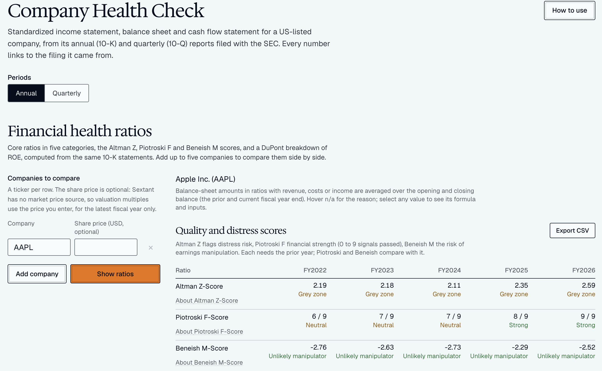
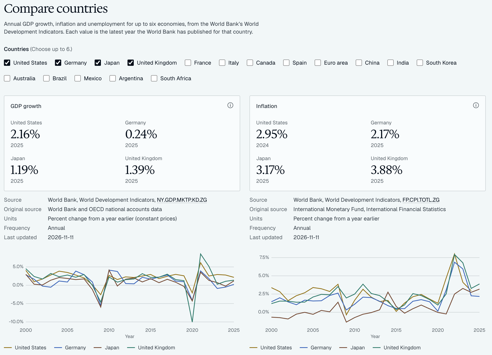
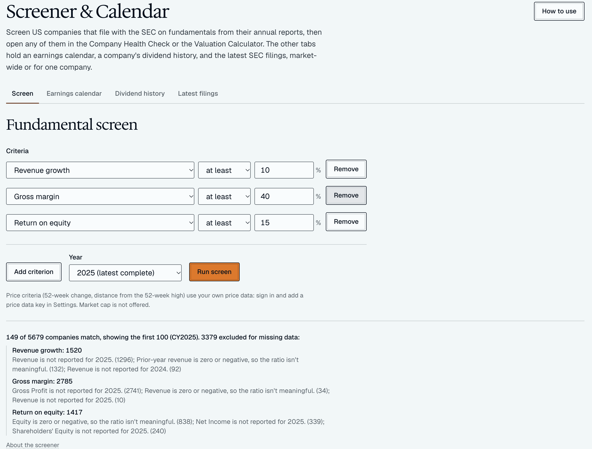

# Sextant

[](https://github.com/JoshLiu111/sextant/actions/workflows/ci.yml)

**Free, transparent finance tools. Every number shows how it was computed.**

**Live:** [sextant.vercel.app](https://sextant.vercel.app)

Sextant is a suite of eight finance tools plus an AI analyst that is not allowed to make numbers up. Every figure Claude writes has to cite the calculation that produced it, and the app checks the citation before you see it.



| Macro: compare countries | Screener & calendar |
|---|---|
|  |  |

## The tools

| Tool | What it does |
|---|---|
| **Options Calculator** | Black-Scholes pricing and Greeks, implied-volatility solver, binomial American options, multi-leg strategies |
| **Risk & Performance** | Historical, parametric and Cornish-Fisher VaR/CVaR with a Kupiec backtest; GARCH(1,1) volatility; Fama-French and Carhart factor regressions |
| **My Portfolio** | CSV import, positions and returns, FIFO realized P&L, multi-currency reporting, efficient-frontier construction |
| **Company Health Check** | SEC EDGAR fundamentals with Altman Z, Piotroski F, Beneish M and DuPont analysis |
| **Valuation** | FCFF DCF with WACC |
| **Macro Dashboard** | US rates and yield curve, FRED series, cross-country comparison (World Bank) and the euro area (ECB) |
| **Screener & Calendar** | Screen companies and track upcoming events |
| **AI Analyst** | Ask questions in plain English; answers are grounded in the tools' own calculations |

## How the AI stays honest

LLMs are good at explaining numbers and bad at producing them. Sextant splits the two jobs:

1. The Python compute service does every calculation and gives each result an ID.
2. Claude writes the explanation, and every number it writes must cite one of those IDs.
3. Each cited number is checked against the computed value for **precision, unit and sign**. A number with no citation is flagged in the UI instead of being shown as fact.

## Architecture

```
Browser
  │
  ▼
Next.js 16 / React 19 / TypeScript / Tailwind 4   (apps/web)
  │  /api/compute
  ▼
Python 3.12 / FastAPI / numpy, pandas, scipy      (apps/compute)
  │
  ├── PostgreSQL (Neon): users, sessions, portfolios, AI usage ledger
  ├── Claude via Vercel AI Gateway
  └── Public data: SEC EDGAR, FRED, US Treasury, World Bank, ECB, Frankfurter
```

Both services deploy together as one Vercel project (`vercel.json`).

## Engineering highlights

- **Quant methods from first principles.** GARCH(1,1) is fit by maximum likelihood with a hand-written Nelder-Mead optimizer; VaR models are backtested, not just computed.
- **Concurrency-safe AI quota and cost ledger.** Postgres advisory locks keep usage accounting correct under parallel requests. Tokens from a failed call count toward operator cost but not the user's quota.
- **Bring your own keys, stored safely.** Users can connect their own market-data keys (Tiingo, FMP). Keys are encrypted with AES-256-GCM under HKDF-derived keys, and each ciphertext is bound to its user and provider.
- **Sign-in.** Google OIDC with replay protection; sessions use hashed opaque tokens.
- **No look-ahead.** Fundamentals are stored as first reported (point in time), so a backtest can't see restated numbers.
- **Licensing enforced in code.** For example, a FRED series is served only if FRED tags it public domain ([ADR 0006](docs/adr/0006-fred-public-domain-check-for-chosen-series.md)).
- **Demo data.** Price-based tools run on synthetic demo data, so visitors can try them without bringing an API key.

## Testing

- **831 pytest tests** for the compute service, run against a real PostgreSQL 16 database.
- **319 Playwright end-to-end tests** in 43 files, covering every tool.
- The e2e suite runs against **10 fake upstream servers** (Google OIDC, Anthropic, SEC EDGAR, FRED, US Treasury, World Bank, ECB, Frankfurter, Tiingo, FMP), so CI is deterministic and never calls a live API.
- GitHub Actions runs lint, typecheck, pytest and Playwright on every push.

## Design decisions

Key decisions are recorded as Architecture Decision Records in [`docs/adr`](docs/adr):

1. [Accounts: web runs Google sign-in, compute owns users, sessions and the database](docs/adr/0001-accounts-sessions-and-user-owned-data.md)
2. [Rates: the yield curve comes from the US Treasury par yield curve](docs/adr/0002-treasury-yield-curve-source.md)
3. [Factors: synthetic demo data, or the user's own upload](docs/adr/0003-factor-data-synthetic-demo-and-user-supplied.md)
4. [Realized P&L: FIFO lots booked at import](docs/adr/0004-realized-pnl-fifo-lots-booked-at-import.md)
5. [Macro beyond the US: World Bank and ECB](docs/adr/0005-world-bank-and-ecb-macro-sources.md)
6. [FRED: serve only public-domain series](docs/adr/0006-fred-public-domain-check-for-chosen-series.md)
7. [Reporting currency: convert each amount at its own date's rate](docs/adr/0007-reporting-currency-at-each-amounts-own-date.md)

## Development

Requires Node 22+, Python 3.12+ and [uv](https://docs.astral.sh/uv/).

```sh
# compute service on :8000
cd apps/compute && uv sync && uv run uvicorn main:app --reload --port 8000
# frontend on :3000 (proxies /api/compute to :8000)
cd apps/web && npm install && npm run dev

# tests
cd apps/compute && uv run pytest
cd apps/web && npx playwright install chromium && npm run test:e2e
```

Environment variables are listed by name in `.env.example`. Never commit values.

## How it was built

Built by [Xuanyou (Josh) Liu](https://github.com/JoshLiu111) with Claude Code as the daily development tool, working from a written spec ([`docs/specs/01-sextant.md`](docs/specs/01-sextant.md)), ADRs and an issue/PR workflow. Inspired by [FinanceToolkit](https://github.com/JerBouma/FinanceToolkit).

*Not investment advice.*
